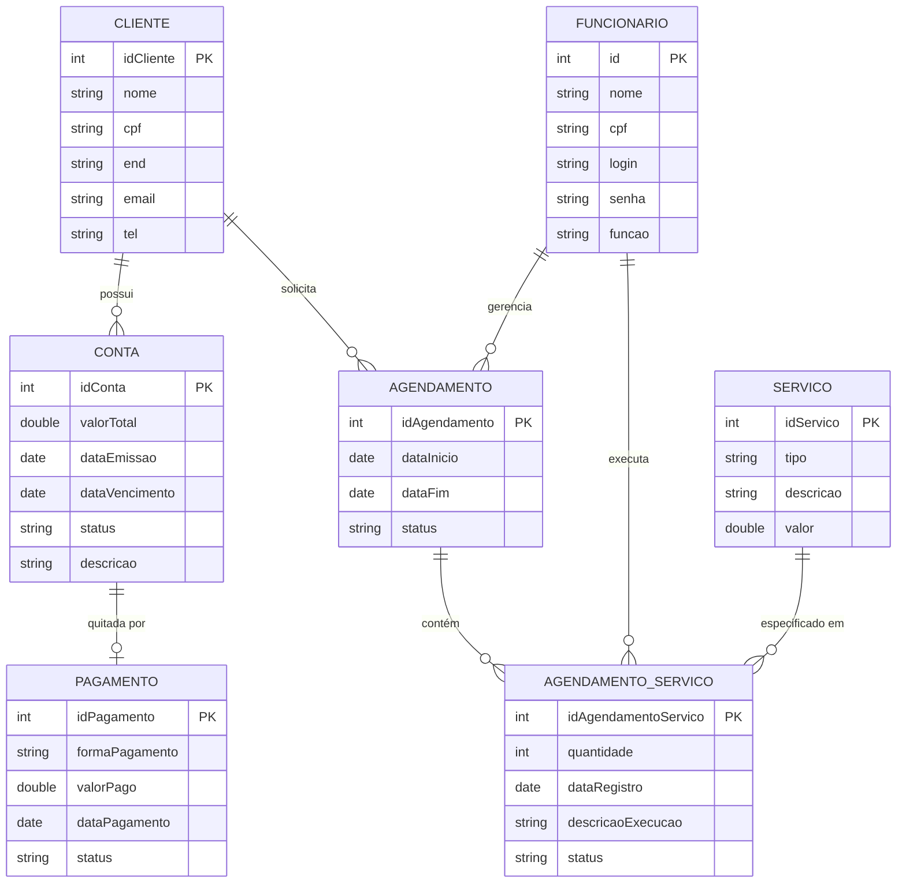

# Documento de Visão

Documento construído a partir do **Modelo BSI - Doc 001 - Documento de Visão** e adaptado para o projeto de Sistema de Gerenciamento de Serviços de Energia Solar.

## Descrição do Projeto

Desenvolver um sistema secundário interligado ao sistema integrado da empresa de Energia Solar Fotovoltaica, visando centralizar as informações relacionadas aos serviços, clientes e atendimentos. O sistema permitirá cadastrar clientes, controlar a quantidade de instalações e manutenções, armazenar os históricos e consultar informações de forma organizada e rápida. Além disso, será possível visualizar horários disponíveis, realizar e gerenciar agendamentos, e gerar contas a receber com opções de pagamento direto pelo cliente.

## Equipe e Definição de Papéis

Membro     |     Papel   |   E-mail   |
---------  | ----------- | ---------- |
Marcos Vinícius Dantas da Silva    | Desenvolvedor  | marcos.silva.714@ufrn.edu.br
Thiago Gomes de Oliveira    | Desenvolvedor, Produtor Criativo | thiago.oliveira.thiagobraga2a@gmail.com
Thiago Alexandre Braga de Medeiro        | Desenvolvedor |  thiagobraga2a@gmail.com
Vinícius Dantas de Souza  |  Desenvolvedor | maria@silva.com

### Matriz de Competências

Membro     |     Competências   |
---------  | ----------- |
Marcos Vinícius Dantas da Silva     | Python, C, JavaScript, HTML, CSS, Dart, Octave, Assembly MIPS|
Thiago Gomes de Oliveira    | Python, C,  Dart, JavaScript, HTML, CSS, Machine Learning|
Thiago Alexandre Braga de Medeiro         | Python, Java, C, MySQL, JavaScript, HTML, CSS|
Vinícius Dantas da Silva      | Gestão, Desenvolvedor Java, Pesquisadora em Engenharia de Software |

## Perfis dos Usuários

O sistema poderá ser utilizado por diversos usuários. Temos os seguintes perfis/atores baseados nas necessidades da empresa:

Perfil                                 | Descrição   |
---------                              | ----------- |
Assistente Administrativo | Responsável pelo cadastro de clientes, gerenciamento de serviços, agendamentos e geração de contas.
Técnico | Responsável por registrar a conclusão dos serviços realizados.
Cliente | Responsável pelo pagamento das contas geradas pelos serviços prestados.

## Lista de Requisitos Funcionais

### Entidade Cliente - US01 - Manter Cliente
O sistema deverá manter o registro e controle de todos os clientes da empresa de energia solar. Os dados cadastrados dos clientes incluem: nome, CPF, telefone, e-mail e endereço.

Requisito                     | Descrição   | Ator |
---------                     | ----------- | ---------- |
RF01.01 - Inserir Cliente     | Insere novo cliente informando: nome, CPF, telefone, e-mail e endereço. | Assistente Administrativo |
RF01.02 - Listar Clientes     | Consultar o perfil e os dados dos clientes utilizando o CPF como filtro principal. | Assistente Administrativo |
RF01.03 - Atualizar Cliente   | Altera informações do cliente como nome, e-mail, telefone ou endereço. | Assistente Administrativo |
RF01.04 - Deletar Cliente     | Exclui o perfil do cliente no sistema, bloqueado caso o cliente tenha agendamentos marcados ou pagamentos pendentes. | Assistente Administrativo |

---

### Entidade Serviço - US02 - Manter Serviço
O sistema deve gerenciar os tipos de serviços fornecidos, como instalação e manutenção de equipamentos. Cada serviço possui nome, tipo, descrição e valor.

Requisito                     | Descrição   | Ator           |
---------                     | ----------- | ----------     |
RF02.01 - Inserir Serviço     | Cadastra novo serviço informando nome, tipo (instalação ou manutenção), descrição e valor, não permitindo duplicatas. | Assistente Administrativo |
RF02.02 - Listar Serviços     | Pesquisa e exibe o catálogo de serviços, permitindo filtros por tipo de categoria. | Assistente Administrativo |
RF02.03 - Atualizar Serviço   | Edita os dados de um serviço previamente cadastrado. | Assistente Administrativo |
RF02.04 - Deletar Serviço     | Exclui ou inativa um serviço, bloqueando a ação caso existam agendamentos futuros vinculados a ele. | Assistente Administrativo |

---

### Entidade Agendamento - US03 - Manter Agendamentos
O sistema permite o gerenciamento da agenda de instalações e manutenções vinculadas aos clientes.

Requisito                     | Descrição   | Ator           |
---------                     | ----------- | ----------     |
RF03.01 - Inserir Agendamento | Cria um agendamento vinculando um cliente cadastrado e o tipo de serviço solicitado. | Assistente Administrativo |
RF03.02 - Listar Agendamentos | Consulta agendamentos registrados utilizando campos de filtro específicos. | Assistente Administrativo |
RF03.03 - Atualizar Agendamento| Altera informações de um agendamento já registrado. | Assistente Administrativo |
RF03.04 - Deletar Agendamento | Cancela um agendamento de serviço marcado. | Assistente Administrativo |

---

### Entidade Histórico - US04 - Serviços Realizados
Trata da conclusão prática dos serviços no sistema e da extração de relatórios de atividades.

Requisito                     | Descrição   | Ator           |
---------                     | ----------- | ----------     |
RF04.01 - Registrar Conclusão | Permite que o técnico informe o encerramento de instalações ou manutenções realizadas. | Técnico |
RF04.02 - Gerar Histórico     | Guarda e gera relatórios de serviços prestados, permitindo filtragem por data, cliente ou tipo de serviço, com exportação disponível. | Assistente Administrativo |

---

### Entidade Conta e Pagamento - US05 - Financeiro
Módulo para lidar com as cobranças e o pagamento integrado dos serviços.

Requisito                     | Descrição   | Ator           |
---------                     | ----------- | ----------     |
RF05.01 - Gerar Conta a Receber| Gera automaticamente uma conta a receber vinculada ao cliente logo após o registro de conclusão do serviço. | Técnico (Via Sistema) |
RF05.02 - Pagar Conta         | Permite que o cliente consulte suas contas pendentes e realize o pagamento (PIX, Cartão ou Boleto), atualizando o status e emitindo comprovante. | Cliente |

---

### Modelo Conceitual

Abaixo apresentamos o modelo conceitual usando o **Mermaid**, extraído diretamente da arquitetura de classes e dados do sistema de energia solar.

#### Descrição das Entidades
*   **Cliente**: Armazena os dados pessoais e de contato para vinculação a serviços e cobranças.
*   **Serviço**: Catálogo central de serviços da empresa, contendo tipo, descrição e valor base.
*   **Agendamento**: Registro de marcações de datas de início e fim para atendimentos aos clientes.
*   **AgendamentoServico**: Tabela associativa que detalha a execução e quantidade de um serviço específico dentro de um agendamento.
*   **Conta**: Registro de cobrança gerado automaticamente após a conclusão de serviços.
*   **Pagamento**: Dados e status das transações financeiras (PIX, Cartão, Boleto) quitando as contas.
*   **Funcionário**: Representa Assistentes Administrativos e Técnicos que operam o sistema.

## Lista de Requisitos Não-Funcionais

Requisito                                 | Descrição   |
---------                                 | ----------- |
RNF01 - Estrutura de hardware             | O sistema deverá funcionar em computadores desktop ou notebooks com acesso à internet. |
RNF02 - Segurança                         | O acesso ao sistema e suas funções deverá ocorrer exclusivamente através de login e senha. |
RNF03 - Tempo de resposta                 | As consultas realizadas pelo sistema deverão ser exibidas em no máximo 5 segundos. |
RNF04 - Compatibilidade                   | O sistema deverá ser compatível com os navegadores baseados em Chromium e Mozilla Firefox. |
RNF05 - Padronização                      | As telas do sistema deverão possuir o mesmo padrão de menus, botões e navegação. |
RNF06 - Acessibilidade                    | O sistema deverá ser acessível, apresentando ferramentas de zoom, alteração de cores e redução de animações. |
RNF07 - Segurança de Pagamento            | Toda a transação financeira realizada deve ser criptografada por meio de SSL/TLS e operacional 24h por dia. |