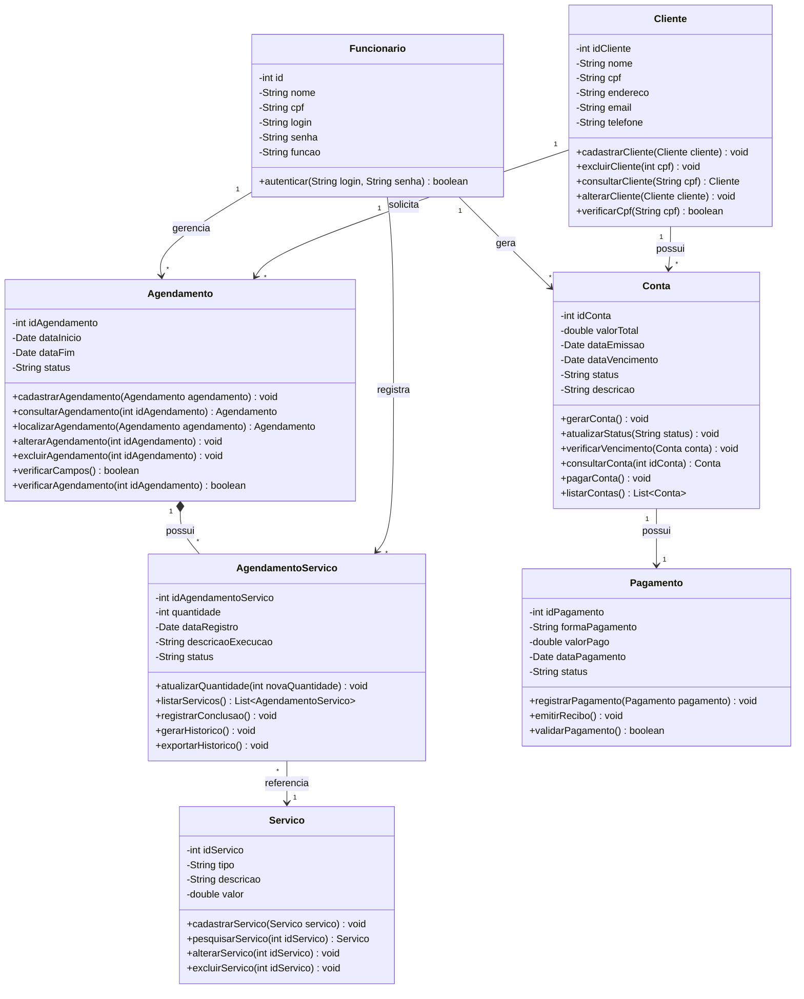
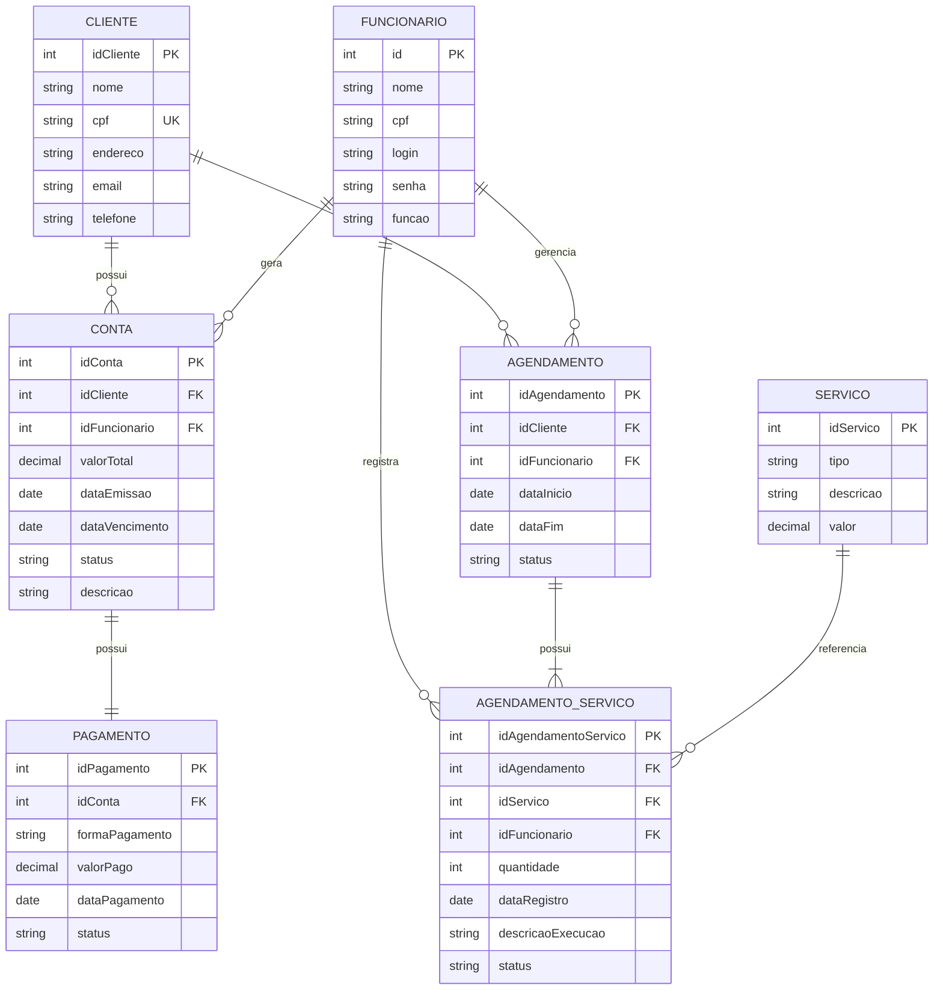

# Documento de Modelos

Este documento apresenta os modelos conceitual e de dados do sistema da Sol Energy Engenharia. São apresentados o diagrama de classes UML, a descrição das entidades, o diagrama Entidade-Relacionamento (ER) e o dicionário de dados.

## 1. Modelo Conceitual

### 1.1. Diagrama de Classes usando Mermaid

O diagrama de classes representa as principais entidades do sistema, seus atributos, métodos e relacionamentos.

### 1.2. Descrição das Entidades

A tabela abaixo apresenta uma descrição das entidades presentes no sistema.

| Entidade | Descrição |
|---|---|
| Cliente | Representa os clientes da empresa, armazenando informações pessoais e de contato, como nome, CPF, endereço, e-mail e telefone. |
| Funcionário | Representa os funcionários da empresa, contendo informações de identificação, login, senha e função. É responsável pelo acesso ao sistema e pelo gerenciamento dos serviços. |
| Serviço | Representa os serviços oferecidos pela empresa, como instalações e manutenções de equipamentos fotovoltaicos, armazenando tipo, descrição e valor. |
| Agendamento | Representa os agendamentos realizados pelos clientes, armazenando as datas de início e término e o status do atendimento. |
| AgendamentoServico | Representa os serviços associados a um agendamento, armazenando quantidade, data de registro, descrição da execução e status. Também permite registrar conclusões e gerar históricos. |
| Conta | Representa as contas geradas pelos serviços prestados, armazenando valor total, datas de emissão e vencimento, status e descrição. |
| Pagamento | Representa os pagamentos realizados pelos clientes, armazenando forma de pagamento, valor pago, data e status da transação. |

## 2. Modelo de Dados (Entidade-Relacionamento)

O modelo Entidade-Relacionamento representa a estrutura dos dados utilizados pelo sistema, identificando as entidades, seus atributos e os relacionamentos existentes entre elas.

### 2.1. Diagrama Entidade-Relacionamento usando Mermaid

### 2.2. Dicionário de Dados

O dicionário de dados apresenta a descrição dos atributos de cada entidade, seus respectivos tipos de dados e as restrições de domínio.

#### Tabela: Cliente

| Nome | Descrição | Tipo de Dado | Tamanho | Restrições de Domínio |
|---|---|---|---|---|
| idCliente | Identificador do cliente | INT | --- | PK / Identity |
| nome | Nome completo do cliente | VARCHAR | 150 | NOT NULL |
| cpf | CPF do cliente | VARCHAR | 11 | UNIQUE / NOT NULL |
| endereco | Endereço do cliente | VARCHAR | 200 | NOT NULL |
| email | E-mail do cliente | VARCHAR | 150 | NOT NULL |
| telefone | Telefone do cliente | VARCHAR | 20 | NOT NULL |

#### Tabela: Funcionario

| Nome | Descrição | Tipo de Dado | Tamanho | Restrições de Domínio |
|---|---|---|---|---|
| id | Identificador do funcionário | INT | --- | PK / Identity |
| nome | Nome completo do funcionário | VARCHAR | 150 | NOT NULL |
| cpf | CPF do funcionário | VARCHAR | 11 | UNIQUE / NOT NULL |
| login | Login de acesso ao sistema | VARCHAR | 50 | UNIQUE / NOT NULL |
| senha | Senha de acesso ao sistema | VARCHAR | 255 | NOT NULL |
| funcao | Função desempenhada pelo funcionário | VARCHAR | 50 | NOT NULL |

#### Tabela: Servico

| Nome | Descrição | Tipo de Dado | Tamanho | Restrições de Domínio |
|---|---|---|---|---|
| idServico | Identificador do serviço | INT | --- | PK / Identity |
| tipo | Tipo do serviço (instalação ou manutenção) | VARCHAR | 50 | NOT NULL |
| descricao | Descrição do serviço oferecido | VARCHAR | 250 | NOT NULL |
| valor | Valor cobrado pelo serviço | DECIMAL | 10,2 | NOT NULL |

#### Tabela: Agendamento

| Nome | Descrição | Tipo de Dado | Tamanho | Restrições de Domínio |
|---|---|---|---|---|
| idAgendamento | Identificador do agendamento | INT | --- | PK / Identity |
| idCliente | Cliente responsável pelo agendamento | INT | --- | FK / NOT NULL |
| idFuncionario | Funcionário responsável pelo agendamento | INT | --- | FK / NOT NULL |
| dataInicio | Data de início do agendamento | DATE | --- | NOT NULL |
| dataFim | Data de término do agendamento | DATE | --- | NOT NULL |
| status | Situação atual do agendamento | VARCHAR | 30 | NOT NULL |

#### Tabela: AgendamentoServico

| Nome | Descrição | Tipo de Dado | Tamanho | Restrições de Domínio |
|---|---|---|---|---|
| idAgendamentoServico | Identificador do serviço associado ao agendamento | INT | --- | PK / Identity |
| idAgendamento | Agendamento ao qual o serviço pertence | INT | --- | FK / NOT NULL |
| idServico | Serviço associado ao agendamento | INT | --- | FK / NOT NULL |
| idFuncionario | Funcionário responsável pela execução | INT | --- | FK / NOT NULL |
| quantidade | Quantidade de serviços realizados | INT | --- | NOT NULL |
| dataRegistro | Data de registro do serviço | DATE | --- | NOT NULL |
| descricaoExecucao | Descrição da execução do serviço | VARCHAR | 500 | --- |
| status | Situação atual do serviço | VARCHAR | 30 | NOT NULL |

#### Tabela: Conta

| Nome | Descrição | Tipo de Dado | Tamanho | Restrições de Domínio |
|---|---|---|---|---|
| idConta | Identificador da conta | INT | --- | PK / Identity |
| idCliente | Cliente responsável pela conta | INT | --- | FK / NOT NULL |
| idFuncionario | Funcionário responsável pela geração da conta | INT | --- | FK / NOT NULL |
| valorTotal | Valor total da conta | DECIMAL | 10,2 | NOT NULL |
| dataEmissao | Data de emissão da conta | DATE | --- | NOT NULL |
| dataVencimento | Data de vencimento da conta | DATE | --- | NOT NULL |
| status | Situação da conta (pendente ou pago) | VARCHAR | 30 | NOT NULL |
| descricao | Descrição referente à conta | VARCHAR | 250 | --- |

#### Tabela: Pagamento

| Nome | Descrição | Tipo de Dado | Tamanho | Restrições de Domínio |
|---|---|---|---|---|
| idPagamento | Identificador do pagamento | INT | --- | PK / Identity |
| idConta | Conta referente ao pagamento | INT | --- | FK / UNIQUE / NOT NULL |
| formaPagamento | Forma utilizada para pagamento (PIX, cartão ou boleto) | VARCHAR | 30 | NOT NULL |
| valorPago | Valor efetivamente pago | DECIMAL | 10,2 | NOT NULL |
| dataPagamento | Data em que o pagamento foi realizado | DATE | --- | NOT NULL |
| status | Situação atual do pagamento | VARCHAR | 30 | NOT NULL |